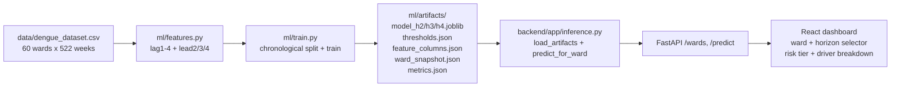

# Architecture — Dengue Ward-Risk Prototype

## Data flow

Training is offline and run once per dataset update (requires `data/dengue_dataset.csv`, gitignored).
Serving reads only the committed artifacts in `ml/artifacts/` — it never touches the raw CSV, which
is what lets a fresh clone launch in ≤3 minutes without the dataset present.

## Chronological validation split

Train on `date <= 2023-12-31`, validate on `2024-01-01..2024-12-31`, test on `date >= 2025-01-01`.
No shuffling, no k-fold. This matches the brief's own "weeks-ahead early-warning" framing: a
model that leaked 2024/2025 weather patterns into training (via shuffled k-fold) would be scored
on its ability to memorize the future, not forecast it. After dropping rows with incomplete
lag/lead history (first/last 1-4 weeks per ward, ~240 rows each end), the three splits are
24,780 / 3,180 / 2,880 rows.

Risk tier thresholds are computed on the **train split only**, not the full dataset, for the same
leakage reason: `medium_max = 4.0`, `high_max = 10.0` (train split p75/p90 of `dengue_cases`,
each forced to be strictly increasing). Tiers: **Low: predicted < 0.5** (the model's Poisson
output is continuous and essentially never lands on exactly 0, but `dengue_cases` is always an
integer — 0.5 is the value below which a prediction rounds to 0 cases, not an arbitrary cutoff),
Medium 0.5–4, High 5–10, Critical 11+.

## Model selection

Forecasting is **direct multi-horizon**, not recursive: three independently trained models
(`model_h2`, `model_h3`, `model_h4`) each map the same 15-feature vector — `rainfall_mm`,
`avg_temp_c`, `relative_humidity_pct` lagged 1–4 weeks (12 features) plus `population_density_sqkm`,
`water_logging_risk_index`, `sanitation_score` (3 static features) — straight to their own
specific future target (`dengue_cases` 2, 3, or 4 weeks out). No lag0 (current-week) feature
exists: the 7–14-day mosquito-breeding-and-incubation lag means same-week rain isn't expected to
predict same-week cases. A recursive design (feeding week+1's prediction back in as if real, to
forecast week+2) was deliberately avoided — it compounds error, since a bad early forecast would
corrupt every later one; every horizon here is anchored to the same real, uncorrupted 4-week
window instead.

**Evidence, not assumption.** Twelve candidates were compared on the identical chronological
split and 15-feature set: linear regression, ridge, random forest, extra trees, gradient boosting,
HistGradientBoosting, XGBoost, LightGBM — most in both squared-error and Poisson-objective form —
against a naive "always predict the train-split median" baseline.

| model                    | h2 MAE | h3 MAE | h4 MAE | avg MAE |
|--------------------------|--------|--------|--------|---------|
| **lightgbm_poisson (winner)** | 1.315 | 1.493 | 1.682 | **1.497** |
| hist_gb_poisson (statistical tie) | 1.264 | 1.492 | 1.738 | 1.498 |
| xgboost_poisson          | 1.302  | 1.554  | 1.650  | 1.502   |
| extra_trees_poisson      | 1.337  | 1.541  | 1.717  | 1.532   |
| lightgbm (squared-error)  | 1.356  | 1.527  | 1.781  | 1.555   |
| gradient_boosting        | 1.349  | 1.620  | 1.787  | 1.585   |
| random_forest_poisson    | 1.363  | 1.636  | 1.778  | 1.592   |
| random_forest            | 1.405  | 1.636  | 1.846  | 1.629   |
| xgboost                  | 1.443  | 1.689  | 1.949  | 1.694   |
| ridge                    | 1.778  | 1.982  | 2.198  | 1.986   |
| linear_regression        | 1.778  | 1.982  | 2.198  | 1.986   |
| naive (train median)     | 2.577  | 2.578  | 2.578  | 2.578   |

`extra_trees_poisson` uses hyperparameters from a teammate's independent, more rigorous
model-selection run (walk-forward CV, Optuna tuning, 57-feature set) where Extra Trees was the
validated winner. Re-tested here, on our leaner 15-feature set, it ranks 4th — confirming that
result was feature-set-driven (bagging's variance reduction helps more with many correlated
inputs; boosting's sequential error-correction has more to work with on fewer, concentrated
features), not evidence that bagged trees generally beat boosting for this problem.

Every Poisson-objective variant beat its squared-error counterpart — expected, since 58% of
`dengue_cases` rows are 0 and a Poisson loss matches that count-data shape better than squared
error. **Winner: `lightgbm_poisson`**, beating the naive baseline by ~42%. It is statistically
tied with `hist_gb_poisson` (0.001 MAE apart) but was chosen over it for a concrete reason, not a
numerical one: `HistGradientBoostingRegressor` has no `feature_importances_` attribute, so it
would silently return all-zero driver importances in production rather than erroring —
`lightgbm_poisson` keeps the driver-breakdown feature (dashboard requirement) working correctly.

Final per-horizon test-split metrics (`ml/artifacts/metrics.json`):

| horizon | MAE   | RMSE  |
|---------|-------|-------|
| 2 weeks | 1.315 | 2.469 |
| 3 weeks | 1.493 | 2.686 |
| 4 weeks | 1.682 | 3.081 |

**Limitation, stated plainly:** the 15-feature comparison above (and the `extra_trees_poisson`
head-to-head) used the same 2025 split both to pick the winning model *and* to report its MAE —
so these numbers are optimistic, not an untouched holdout score. A stricter setup would reserve
test purely for final reporting after model selection is locked on validation alone.

**Driver breakdown uses per-prediction contributions, not global feature importance.**
`backend/app/inference.py` calls `model.predict(vector, pred_contrib=True)` rather than reading
`model.feature_importances_` — the latter is a single array fixed at training time, identical for
every ward and every request, which would make the dashboard show the same top-5 "drivers" no
matter what was predicted. `pred_contrib` gives each feature's actual push on *that* prediction
(log-space, since the objective is Poisson), so different wards correctly show different drivers.

## Data caveats

The dataset is clean and likely synthetic: `max_temp_c`/`min_temp_c` are identical across every
ward within a given city-week, and `rainfall_mm`/`relative_humidity_pct`/`avg_temp_c` are
partially shared across wards in the same city-week rather than fully independent per ward. This
documentation makes no claim of real-world validity or fully independent ward-level weather —
the model and its evaluation should be read as a prototype exercise on this dataset, not as a
validated real-world forecasting tool.

## Compute and API cost efficiency

Inference is local and offline: `joblib.load` three ~hundred-KB model files plus small JSON
artifacts at FastAPI startup, then `model.predict()` per request — no external API calls, no LLM
tokens, at prediction time. The brief requires *minimizing* API calls (criteria 3 and 6), not
eliminating them; zero external calls was chosen as the simplest way to satisfy that, not because
it's mandated. A live weather API was considered and explicitly deferred (see `plan.md`'s
"Future: live-weather fetch window" section) — it isn't one of the three named bonus options and
risks the "bloated API loops" penalty in criterion 6 for no scoring benefit this round.
