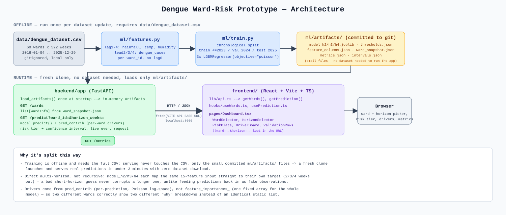

# AI for Urban Dengue Outbreak — Ward-Level Risk Prediction

**Team:** Arman, Sayeed, Ahnaf — EDU AI Engineering Hackathon 2026, Preliminary Round (24-hour qualifier).

## What this is

Dengue outbreaks in Bangladeshi cities lag 2–4 weeks behind the rain that causes them: stagnant
water takes 7–14 days to breed adult Aedes aegypti mosquitoes, plus viral incubation before
symptoms show. By the time hospital admissions spike, mosquito-control teams are already weeks
behind. This project ingests weekly ward-level weather data, builds multi-week rainfall/temperature/
humidity lag features per ward, and trains an ML model that forecasts dengue case-rate 2–4 weeks
ahead per ward — converted into a Low / Medium / High / Critical risk tier and shown in a web
dashboard with the main weather drivers behind each prediction.

Full rationale and design decisions: [requirement.md](requirement.md), [plan.md](plan.md),
[ARCHITECTURE.md](ARCHITECTURE.md) (data-flow diagram, chronological-split rationale, full
12-candidate model comparison with evidence).

## Architecture



**How the model works.** Three independently trained LightGBM regressors (`model_h2`, `model_h3`,
`model_h4`) each map the same 15-feature vector — `avg_temp_c`/`rainfall_mm`/`relative_humidity_pct`
lagged 1–4 weeks per ward (12 features, deliberately no same-week "lag0": the 7–14-day
mosquito-breeding-and-incubation lag means this week's rain isn't a predictor of this week's
cases) plus 3 static ward-vulnerability features — straight to their own target: `dengue_cases`
2, 3, or 4 weeks out. This is **direct multi-horizon forecasting**, not recursive: no model's
output ever feeds back in as a fake "observed" input for another, so a bad short-horizon guess
can't corrupt a longer one. Each model uses a **Poisson objective** (not the LightGBM default
squared-error loss) because the target is a zero-inflated count (58% of weeks have 0 cases) —
chosen after comparing 12 candidates on the identical chronological split; see `ARCHITECTURE.md`
for the full table and the evidence behind every one of these choices. Predictions map to a
Low/Medium/High/Critical tier via train-split-only quantile thresholds, and to a 90% confidence
interval via a residual-quantile band scaled by `sqrt(predicted)` (Poisson variance grows with the
mean). Per-ward "weather drivers" come from LightGBM's `pred_contrib` — each feature's actual
push on *that specific prediction* — not `feature_importances_`, which is one fixed array for the
whole model and would show the identical top-5 list for every ward.

**How frontend and backend connect.** `backend/app/main.py` (FastAPI) loads `ml/artifacts/` once
at startup and serves three read-only GET endpoints: `/wards` (the 60 wards, from
`ward_snapshot.json`), `/predict?ward_id=&horizon_weeks=` (runs the real model live, every
request — not a cached/precomputed lookup), and `/metrics` (the chronological test-split MAE/RMSE
per horizon). `frontend/src/lib/api.ts` calls these over plain `fetch` against
`VITE_API_BASE_URL` (`frontend/.env`, defaults to `http://localhost:8000`); `hooks/useWards.ts`
and `hooks/usePrediction.ts` wrap that in React state, and `pages/Dashboard.tsx` wires the ward
and horizon selectors (kept in the URL's search params) to the risk-tier plate and driver
breakdown. No shared code between the two — the only contract is the JSON shape FastAPI's
Pydantic models (`backend/app/schemas.py`) produce and the frontend's TypeScript types
(`frontend/src/types/api.ts`) expect.

## Dataset

`data/dengue_dataset.csv` — 31,320 rows, weekly cadence, **2016-01-04 to 2025-12-29**, covering
**60 wards across 5 cities** (Dhaka North, Dhaka South, Chattogram, Gazipur, Narayanganj). No
missing values.

| Column | Meaning |
|---|---|
| `date` | Week start date |
| `city`, `ward_id` | Location |
| `population_density_sqkm` | Static ward crowding |
| `water_logging_risk_index` | Static ward drainage vulnerability (0–1) |
| `sanitation_score` | Static ward waste-collection quality (0–1) |
| `avg_temp_c`, `max_temp_c`, `min_temp_c` | Weekly temperature |
| `rainfall_mm` | Weekly rainfall |
| `relative_humidity_pct` | Weekly humidity |
| `dengue_cases` | Ground-truth weekly case count per ward (target) |

## Environment / versions

| Tool | Required (verified 2026-11-22 across two teammates' machines) |
|---|---|
| Python | **3.11 or newer** (verified working on 3.11.9 and 3.12 — exact package versions are pinned in `requirements.txt`, so any Python new enough to install them works) |
| Node.js | **26.13.1 LTS** (`winget upgrade --id OpenJS.NodeJS.LTS`) |
| npm | bundled with Node |
| git | 2.55+ |

(Earlier draft of this table claimed Python 3.15.2 was required — untested at the time. Don't
install a specific bleeding-edge version just to match that; any 3.11+ install works.)

## Setup

Run every command below from the **repo root** — `backend/app/inference.py` imports the sibling
`ml` package (`from ml.risk import compute_risk_tier`), which only resolves if Python is launched
from the root, not from inside `backend/`.

```powershell
# Backend (FastAPI) — from repo root
python -m venv .venv
.venv\Scripts\activate
pip install -r requirements.txt
uvicorn backend.app.main:app --reload

# Frontend (React) — in a second terminal
cd frontend
npm install
npm run dev
```

## AI assistants and external APIs used

- Claude Code (Anthropic) — planning, scaffolding, and pair-programming assistance. Claude never
  commits to this repo (see `CLAUDE.md`); all commits are authored by the human teammates.
- No external/paid APIs are called at inference time — the risk model runs from a serialized
  local file (see `ARCHITECTURE.md` for the cost/efficiency rationale).
